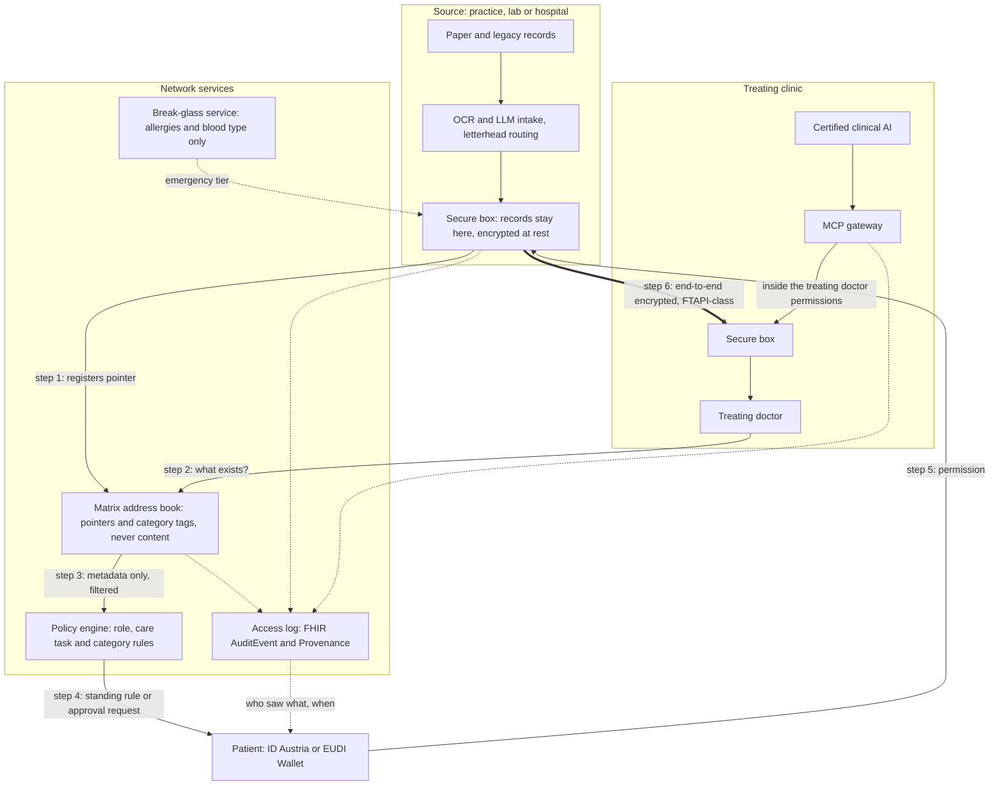

# Brieftaube Network: from a better fax to a patient-controlled health data network

> Clickable vision prototype (front end only, synthetic data): [vision-prototype/index.html](vision-prototype/index.html). Download and open it in a browser, then use the arrow keys to step through.

AIM Healthcare Hackathon 2026, Vienna. Track 2: Health Data Interoperability, a case set by FTAPI. All data is synthetic.

Every feature carries a status label. **Built** means working, tested code. **Simulated** means a stand-in for a real service. **Vision** means designed but not built.

## 1. TL;DR

- **We solved the case (Built).** A doctor inside PGK, the closed Matrix network in FTAPI's case brief, requests a document from a lab or rehab clinic outside it. The recipient answers through a neutral link, a simulated ID Austria sign-in and a browser form. Brieftaube files the answer as FHIR R4 with Provenance.
- **Building it exposed the real bottleneck.** Every request still lands on another overloaded doctor, who has to find the document, check it and send it, unpaid. Transport is solved; the asking is the problem.
- **The law is moving.** The European Health Data Space (EHDS) has been in force since March 2025. Patient summaries and ePrescriptions must flow EU-wide from 2029; images, lab results and discharge reports from 2031.
- **Our vision is the Brieftaube Network.** Records stay where they were made. A Matrix address book knows where they are, never what they contain. The patient releases data through patient-set access permissions, and need-to-know rules limit who sees what. No doctor presses send.
- **Designed to plug into** existing pieces: FTAPI-class encrypted transport, secunet-class certified hardware, ID Austria and the EU Digital Identity (EUDI) Wallet, and CE-marked clinical AI through MCP. It complements ELGA, Austria's national health record, rather than replacing it.

## 2. Where we stand

| Status | What |
|---|---|
| **Built** | Requests from a Matrix room. A neutral email or SMS link that carries no patient data. No install and no account for the outside person, and under 2 minutes to answer (0.4 s in a scripted run; a real person adds reading time). FHIR R4 with Provenance and 0 validation errors. 3 of 3 misdeliveries caught, 6 of 6 audit steps. Jury mode with a QR code, critical-value alerts, a values table, a status board, reminders with link rotation, and a receipt with a SHA-256 fingerprint. |
| **Built, measured** | AI reading with an evidence line for every value. A real Claude run on 30 Oct 2026 at 12:35 got 49 of 51 values right, rejected 17 of 17 hallucination traps, and filed no value without evidence. AI-read answers always wait for the doctor ([AI-EVAL](AI-EVAL.md)). METRICS.md and V2-REPORT.md were written before this run and still call it MOCK. |
| **Built** | "KI-Hilfe für Absender" (AI help for the sender): the AI ranks the sender's archive and pre-fills the answer, but a person still presses "Sicher senden" (send securely). The demo uses a synthetic archive and a cloud model; in real use the model would run locally. |
| **Simulated** | ID Austria, the physician register, email and SMS. A local Synapse server stands in for the case network. There is no end-to-end encryption yet: the prototype runs plain HTTP on localhost, which the case allows. |
| **Vision** | Sections 5 to 16, unless a row says Built or Simulated. |

More detail: [SUBMISSION.md](SUBMISSION.md) · [README.md](../README.md) · [ARCHITECTURE.md](ARCHITECTURE.md)

**Words we use**

| Term | Plain meaning |
|---|---|
| FHIR R4 | The international standard format for exchanging health data (version R4) |
| Provenance | A FHIR record of who sent a document, how they were checked, and when |
| Matrix | An open standard for secure messaging. PGK, the closed network in FTAPI's case brief, runs on it |
| EHDS | European Health Data Space: the EU regulation on sharing health data, Regulation (EU) 2025/327 |
| EHR system | Electronic health record software, such as a practice or hospital system |
| MCP | Model Context Protocol: a standard way for an AI tool to query a data source |
| OCR | Text recognition that turns a scanned page into text |
| Break-glass | Emergency access when the patient cannot decide |
| EUDI Wallet | The European Digital Identity Wallet, an EU-wide digital ID |
| SHA-256 | A digital fingerprint of a file: any change to the file changes the fingerprint |

## 3. We solved the brief, and found the real bottleneck

- **Every request lands on another doctor.** Someone has to find the document, check it, approve it and send it, and nobody pays for that work. Answers can take days, which slows treatment, and meanwhile the treating doctor works without the full picture. Unpaid extra work is easy to put off, so the request model will probably not work at scale as imagined.
- **Our own AI sender assist doesn't change that.** A person still has to check the result and press send. It shouldn't work like this.
- **Doctors are already overloaded,** and they do devoted, often self-sacrificing work. Austrian hospital doctors report spending 39% of their working time on administration. 74% of those under 65 doubt they can keep up this load until 65 ([Austrian Medical Chamber 2025](https://aerztekammer.at/documents/d/content-pool/250324_pk-unterlage_spitalsarzteumfrage-2025)). We must not add a single click to their day.
- **The landscape is fragmented.** Some single-doctor practices keep paper in a locked cabinet. Others run old, insecure systems that need patching. No two servers are alike. Making everything uniform would also mean retraining every doctor on one system.
- **Diagnostics restart from zero.** If you break a leg far from home, or go to another clinic or abroad, the new clinic cannot pull up your records. Someone has to file a request, which costs another doctor time, and X-rays and tests are repeated. In one US study, 20% of transferred patients had a repeat test that was not clinically needed ([Stewart 2010](https://pmc.ncbi.nlm.nih.gov/articles/PMC2995707)).

- Only about 10% of family doctors in Europe share clinical information digitally with other providers ([European Commission, EHDS impact assessment, 2022](https://health.ec.europa.eu/system/files/2022-05/ehealth_ehds_2022ia_4_en.pdf)).

We got the most out of the request model, but it cannot fix the underlying problem.

## 4. The legal clock

> **For the EHDS, it is 2016 again: law already, deadlines ahead.** The GDPR was adopted in 2016 and applied from 2018. For the EHDS, 2029 is the new 2018, so the time to prepare is now.

| When | EHDS milestone ([European Commission](https://health.ec.europa.eu/ehealth-digital-health-and-care/european-health-data-space-regulation-ehds_en), [EUR-Lex](https://eur-lex.europa.eu/eli/reg/2025/327/oj)) |
|---|---|
| March 2025 | Regulation (EU) 2025/327 enters into force |
| 26 March 2027 | It applies in general |
| March 2029 | Patient summaries and ePrescriptions/eDispensations are exchanged in all Member States |
| March 2031 | Medical images, lab results and hospital discharge reports are exchanged too |
| 2029/2031 waves | EHR systems need harmonised interoperability and logging components, plus a CE mark the manufacturer declares itself (exact dates unverified) |
| Date not verified | Member States must connect every provider to MyHealth@EU through a national contact point ([Ringholm](https://www.ringholm.com/ehds/member-state-obligations.htm)) |

- **What this means for us:** from 2029, priority data must be exchangeable across the EU. A model where one doctor answers each request by hand will be outdated by 2029–2030.
- **Patient rights:** patients can restrict access to all or part of their data and see who accessed what, and when. Member States may offer an opt-out, which the patient can reverse.
- **Professional access** depends on role and care task (Art. 11) and requires a recognised eID (Art. 12).
- **GDPR:** treatment data rests on Art. 9(2)(h) plus professional secrecy, not on consent ([GDPR](https://eur-lex.europa.eu/eli/reg/2016/679/oj)). So our approval step is a set of **patient-set access permissions**. It is control beyond what GDPR requires, it matches the EHDS right to restrict access, and it must never block care. Break-glass access rests on vital interests (Art. 9(2)(c)). Whether the EHDS itself allows emergency access to restricted data is unverified (final wording not checked), so we do not rely on it.
- **eIDAS 2:** every Member State must offer an EUDI Wallet by December 2026, and using it is voluntary ([EUR-Lex](https://eur-lex.europa.eu/eli/reg/2024/1183/oj)). ID Austria already logs patients into the ELGA portal ([ELGA](https://www.elga.gv.at/faq/teilnahme-an-elga/)).
- **AI Act:** after the 2026 Digital Omnibus, the high-risk duties for AI in medical devices that need notified-body review apply from 2 August 2028 ([Lewis Silkin](https://www.lewissilkin.com/insights/2026/07/27/the-digital-omnibus-on-ai-enters-into-force-today-102nedo)).
- **NIS2:** Austria's NISG 2026 has applied since 1 October 2026. Hospitals are in scope; most single-doctor practices are not ([Schoenherr](https://schoenherr.eu/media/rmjpcde1/schneider-ecolex-2026-94.pdf)).
- **Fax:** Austria's legal exception for faxing health data (§ 27(12) GTelG 2012) ended on 1 January 2025 ([Health Ministry](https://aekwien.at/documents/d/wien/241128_bmsgpk_rechtliche-rahmenbedingungen-der-faxablose)). Austria plans a Matrix-based platform for directed communication between providers ([futurezone](https://futurezone.at/netzpolitik/gesundheitsakte-elga-wird-komplett-um-und-ausgebaut-app-relaunch/403043601)).

**Feasibility.** Only the first row is Built; all other rows are Vision. This is hackathon research, not legal advice.

| Feature | Legal basis / constraint | Verdict |
|---|---|---|
| Directed request, eID, FHIR, misdelivery checks, audit (Built) | GDPR Art. 32; a misdelivery is a data breach (Arts. 33–34); GTelG | Feasible now |
| Secure box per practice | GDPR Arts. 9 and 32; EHDS Art. 86; the box may count as an EHR system | Feasible; plan for conformity early |
| Address book with category tags | The index is itself health data | Keep minimal, access-controlled metadata, never content |
| Patient-set access permissions | GDPR 9(2)(h); EHDS Arts. 8 and 10; eIDAS 2 | Feasible as extra control; the defaults must never block care |
| Need-to-know by role | EHDS Art. 11; data minimisation | Rules owned by clinicians, not guessed by AI |
| Access log the patient can see | EHDS Art. 9 | Required by law anyway |
| Break-glass: allergies and blood type | GDPR 9(2)(c) | Stricter than the law requires; log every use and notify the patient |
| Automatic release | Treating professionals have access by default, subject to the patient's restrictions | Feasible within a care relationship; keep a human release for psychiatry |
| OCR and letterhead routing | EHDS Art. 13; GDPR accuracy principle | A person confirms before anything is routed |
| MCP access for clinical AI | AI Act from 2028; the MDR intended purpose | Feasible with conditions (section 11) |
| MyHealth@EU | Art. 23(5); European exchange format | FHIR-based, ready to align |

## 5. Design principles

| Principle | In one line | Status |
|---|---|---|
| Federated | Data stays where it was made: no central database, so no single point of failure or breach. Member States may require high protection and storage inside the EU (EHDS Art. 86), which suits on-site boxes | Vision |
| Patient-controlled | The patient releases the data, not a doctor | Vision |
| Need-to-know | Role and care task decide what a professional can even see listed | Vision |
| Zero-touch for the sending doctor | The source box answers; nobody presses send | Vision |
| Bottom-up rollout | It starts wherever there is a scanner | Vision |
| Encrypted everywhere | End to end in transit, and at rest | Vision (the prototype runs plain HTTP on localhost) |
| Certified AI only | AI that is CE-marked for its intended purpose, working inside the doctor's access rights | Vision |
| Everything logged | Every human and AI access, visible to the patient | Built (audit), Vision (patient view) |

## 6. Architecture

| Component | Role | Designed to plug into | Status |
|---|---|---|---|
| Secure box | Holds the practice's records, or sits in front of them, and answers permitted requests automatically | A certified on-site appliance or a certified hosted gateway. One example is secunet-class hardware: secunet builds the konnektor that links German practices to Germany's health network (TI), and the konnektor stores no records ([secunet](https://www.secunet.com/en/products-consulting/secunet-konnektor)) | Vision |
| Matrix address book | Pointers to documents with category tags (imaging, lab, surgery, discharge, psychiatry), never the content. It also knows who may ask for which category (access management). Pointers are filtered by need-to-know too: an MRI radiologist never sees that a psychiatry visit exists. *A postman who knows the addresses but can't open the letters.* | Matrix federation, as in Germany's TI-Messenger ([gematik](https://www.gematik.de/anwendungen/ti-messenger/faq)) | Vision (Built: Matrix room and widget) |
| Encrypted transport | End-to-end encrypted transfer between boxes and to outside parties | FTAPI-class transport. Austria's health insurance fund (ÖGK) offers FTAPI as one replacement for fax ([parliamentary answer](https://www.parlament.gv.at/dokument/XXVIII/AB/407/imfname_1676750.pdf)). FTAPI's public pages advertise no FHIR, EHDS or Matrix support ([FTAPI](https://www.ftapi.com/en/blog/fax-ban)) | Vision |
| Patient approval | Approval through an SMS or e-mail link or an app, plus standing rules | ID Austria and the EUDI Wallet | Vision (Simulated: ID Austria) |
| Policy engine | Rules on role, category and care relationship | National rules under EHDS Art. 11 | Vision |
| Break-glass service | An emergency tier for verified hospitals and registered doctors | Physician register | Vision (Simulated: the register) |
| OCR/LLM intake | Reads paper and handwriting; the letterhead names the source clinic | A model running locally in the practice | Vision (Built: verified AI reading) |
| MCP gateway | Lets certified clinical AI query the network within the treating doctor's access rights | CE-marked clinical AI, Tandem-class | Vision |
| Access log | FHIR AuditEvent and Provenance records | FHIR R4 | Built (audit), Vision (patient view) |

## 7. The request flow: today vs the network

| Step | Today (Built) | Network (Vision) |
|---|---|---|
| 1 | The doctor picks a recipient and a document type | The doctor asks the address book what exists |
| 2 | A neutral link goes out by email or SMS | The doctor sees **metadata only** (institution, date, category), filtered by need-to-know |
| 3 | The recipient signs in with ID Austria (simulated) | The doctor picks what is needed |
| 4 | **A person finds the document, checks it and presses send** | **A patient rule or a one-tap approval releases it from the source box** |
| 5 | Patient check, FHIR filing with Provenance, a message in Matrix | End-to-end encrypted transfer, filed as FHIR with Provenance |
| 6 | A six-step audit | An access log the patient can see |

## 8. Access model

| Requester | Chest X-ray | Knee X-ray | Lab | Psychiatric notes | Allergies, blood type |
|---|---|---|---|---|---|
| Cardiologist | yes | no | yes | hidden, not even listed | yes |
| MRI clinic, knee referral | no | yes | kidney values (for contrast) | hidden | yes |
| Emergency team, patient unconscious | no | no | no | hidden | yes (break-glass) |
| Psychiatrist | no | no | yes | with patient approval | yes |

Clinicians review the rules and can configure them. An override is possible and is logged.

- **Standing category permissions,** for example: "Imaging and lab values are always open to my cardiologist."
- **"Don't bother me" mode:** blanket access for treating professionals, which the patient can revoke at any time. Psychiatry still needs approval.
- **Automated approvals,** for example when the social security number matches a treatment record at the requesting clinic within the stated date range.
- **Emergency tier:** a verified hospital or registered doctor gets allergies and blood type only, and the patient is notified afterwards. Once able to decide, the patient can unlock a broader tier with medication and pre-existing conditions.
- **The family doctor is named in the emergency record,** so the hospital can reach the GP.

## 9. Patient journeys

**Monica (a synthetic patient):**
1. **Emergency abroad, then an operation.** Break-glass gives the hospital her allergies, her blood type and her GP's name. She is notified afterwards, and once awake she unlocks her medication and pre-existing conditions.
2. **Discharge.** A chest X-ray shows an incidental lung finding, which is recorded as an open task.
3. **The GP back home** gets her restrictions (no weight-bearing for 8 weeks) and the open tasks, released by her standing rule.
4. **MRI referral.** The MRI clinic gets the original finding, so it knows which region to scan.
5. **Rehab** gets the surgical report and the restrictions.
6. **The rehab outcome** goes back to the surgeon as quality feedback, after a notification when rehab ends.

**Other journeys:**
- **Open clinical tasks** trigger a notification to the patient, who then starts the share at the next visit.
- **A skier breaks a leg in Tyrol.** The hospital sees allergies at once and earlier imaging after the patient approves, so there is no repeat X-ray. Austria recorded about 31,200 winter-sports injuries in 2024; that figure is not a count of tourists ([KFV](https://www.vienna.at/skifahren-und-co-so-schaffst-du-es-unverletzt-durch-die-wintersportsaison/9829052)).
- **A Hungarian patient fills a Hungarian prescription in Italy.** From 2029 every Member State must exchange ePrescriptions via MyHealth@EU. The goal is that Hungarian insurance covers it, with no out-of-pocket payment, but reimbursement rules are set nationally.
- **Sharing by choice.** The patient can share with an insurer (for example after an injury abroad) or a longevity clinic through the same permission gate, time-limited and logged. This is outside treatment, so Art. 9(2)(h) does not cover it and it needs its own legal basis.

| | Today | With the network |
|---|---|---|
| Emergency abroad | Allergies unknown | Allergies, blood type and GP within minutes |
| Back home | The patient carries paper, the doctor is on vacation, the X-ray is repeated | One approval, the right documents, the same day |
| Incidental finding | Lost between hospital and GP | An open task, and the patient is notified |
| Rehab outcome | Never reaches the surgeon | Quality feedback |
| Sending doctor | Finds, checks and sends, unpaid | Nothing to do |

## 10. Paper and legacy, bottom-up

- **OCR at intake.** When a paper document enters a connected practice, OCR digitises it, with an LLM for handwriting. The original remains the source of truth, and a person confirms before anything is routed.
- **Letterhead routing.** The letterhead names the clinic that issued the document, so requests can reach clinics that are on no network.
- **The map grows with every document.** Over time it shows where a person's data lives.
- **Known limitation.** Many GPs still work on paper or on standalone PCs. Today's prototype assumes documents are already digital; the roadmap adds a secure box plus a scanner.
- **A secure box plus a scanner** for practices that work on paper only, or a hosted gateway instead. Austria's e-card system has already moved from a box in every practice to a central service ([Vienna Medical Chamber](https://www.aekwien.at/documents/263869/411179/210716_Informationsblatt+-+Umstellungen+im+eCard+System.pdf/b9689f8d-7810-1323-b952-898677e52f5a)).
- **A caveat on cloud buffers.** A temporary buffer for small practices may hold pending permission requests only, never records.

## 11. AI layer

- **MCP gateway.** Clinical AI queries the network as a tool. AWS already ships an open-source MCP server for FHIR data ([AWS](https://aws.amazon.com/blogs/industries/building-healthcare-ai-agents-with-open-source-aws-healthlake-mcp-server/)).
- **When something happens to the patient,** the AI gathers the records the treating doctor may see and summarises them. No doctor at the source has to press send.
- **Certified AI only,** for example Tandem Health's CE-marked AI scribe (company statement) ([Tandem](https://tandemhealth.ai/resources/news/tandem-s-ai-scribe-is-now-mdr-class-iia-certified)).
- **The intended purpose sets the limit.** Tandem says its tool is for documentation and coding, not diagnosis ([Tandem](https://tandemhealth.ai/ai-info)). Querying other providers' records would be a new intended purpose and would need its own conformity assessment. We claim no integration.
- **The AI stays within the treating doctor's access rights,** and every AI query goes into the access log.
- **Human oversight.** No one has to press send at the source, but the treating doctor reads the summary and stays responsible. That is already true in today's build: AI-read values carry evidence lines and wait for the doctor's release.

## 12. Competitive landscape

| Solution | Patient approves access | Need-to-know | Cross-border | Reaches paper/legacy | No work for sender | AI-ready | EHDS-ready |
|---|---|---|---|---|---|---|---|
| ELGA incl. e-Befund (AT) | partial | partial | partial* | no | partial | partial | partial |
| DaMe / Medical Net / GNV (AT) | no | partial | no | partial | no | no | no |
| Austria's planned Matrix platform (PGK in the case brief) | no | partial | no* | partial | no | no* | no* |
| Germany's ePA für alle | partial | partial | partial* | partial* | partial | partial | partial |
| KIM + TI-Messenger (DE) | no | partial | no | partial | no | no | no* |
| MyHealth@EU | partial* | partial | yes | no | partial | no | yes |
| EESZT (HU) | partial | partial | partial* | no | partial | partial | partial |
| HIE platforms (InterSystems, Tiani, Dedalus, x-tention)* | partial* | partial* | partial* | partial* | partial* | partial* | partial* |
| Doctolib* | partial* | no* | no* | partial* | no* | partial* | no* |
| Brieftaube MVP (Built) | no | partial | no | partial | no | partial | partial |
| Brieftaube Network (Vision) | yes† | yes† | partial† | partial† | yes† | yes† | partial† |

In the "patient approves access" column, partial means the patient can opt out or restrict access but does not approve each access. An asterisk (\*) marks entries not checked against sources, and a dagger (†) marks design targets.

**The gap we fill:**
- **Nobody presses send.** Push networks secure the transport, but a person still sends every file. Pull records cover only mandated document types from connected providers.
- **Patient-set access permissions plus need-to-know.** Other systems offer opt-out or blanket restriction, but none combines category permissions with role-based limits.
- **Paper and unconnected sources become findable.**
- **Governed AI access.** AI scribes document the visit in front of them; the network gives them audited, scoped context.
- **We complement ELGA, not replace it.** ELGA's mandatory storage grows until 2030; the gap is everything outside it.

## 13. Added value per stakeholder

| Stakeholder | Pain today | Value | Pilot KPI |
|---|---|---|---|
| Treating doctor | Austrian hospital doctors report spending 39% of their time on administration ([Austrian Medical Chamber](https://aerztekammer.at/documents/d/content-pool/250324_pk-unterlage_spitalsarzteumfrage-2025)). Information is missing in 13.6% of primary-care visits, over half of it held elsewhere (US study, [Smith 2005](https://pubmed.ncbi.nlm.nih.gov/15687311/)) | The right categories the same day, plus an AI summary within the doctor's access rights | Minutes from request to chart |
| Sending doctor, lab, rehab clinic | Releases records by hand, unpaid. 74% of hospital doctors under 65 doubt they can keep up the current load until 65 (self-reported, [Austrian Medical Chamber](https://aerztekammer.at/documents/d/content-pool/250324_pk-unterlage_spitalsarzteumfrage-2025)) | Zero-touch release | Manual releases per 100 requests (target: 0) |
| Patient | Carries paper, repeats tests, cannot see who looked | Holds the permissions and sees the access log | Repeat tests per episode |
| Cross-border patient | The EHIC, held by over half of the EU population, covers costs but carries no clinical data ([EC](https://commission.europa.eu/news-and-media/news/european-health-insurance-card-keeping-you-safe-while-travelling-abroad-2024-07-12_en)) | An emergency tier plus permissions given through the wallet | Time to allergy data at admission |
| Hospital | 32% of transferred patients had repeat tests within 12 hours (US study, [Stewart 2010](https://pmc.ncbi.nlm.nih.gov/articles/PMC2995707)) | Fewer repeat tests, misdelivery checks, EHDS conformity off the shelf | Repeat lab rate within 30 days |
| Payer (e.g. ÖGK) | Pays for repeat diagnostics | Fewer unnecessary repeats | Repeat-test cost per episode |
| State | The 2029 and 2031 duties. The Commission estimated EHDS benefits at over EUR 11 billion across ten years; that is an estimate, not savings ([SWD(2022) 132](https://data.consilium.europa.eu/doc/document/ST-8751-2022-ADD-7/en/pdf)) | Exchange that the patient controls, that is logged and FHIR-based | Share of priority documents exchangeable |

We have no pilot data, so we claim no savings. Duplicate imaging only falls when the images themselves move, not just the reports ([US study](https://pmc.ncbi.nlm.nih.gov/articles/PMC7210344)).

## 14. Business model hypotheses (not validated)

- **H1: payers fund it.** Social insurers pay for duplicate tests today, so a payer-funded box or gateway subscription could cost less than the repeats it avoids. A pilot has to measure this.
- **H2: providers buy compliance.** Hospitals and EHR vendors get EHDS-grade logging, access control and interoperability off the shelf, before 2029.
- **H3: no fee per request.** Zero-touch removes the unpaid work, so the sending side needs no incentive. Where a person still releases data (psychiatry), a billable service code is an option.

## 15. Roadmap

| Phase | When | What | Status |
|---|---|---|---|
| 0 | Oct 2026 | Brieftaube MVP: directed requests, FHIR with Provenance, misdelivery checks, audit | Built |
| 1 | 2027 | Regional pilot with one hospital, 5–10 practices, a lab and a rehab clinic: real ID Austria, FTAPI-class transport, KPIs | Vision |
| 2 | 2027–2028 | Secure box, address book, patient permissions through ID Austria and EUDI Wallets, OCR intake, break-glass | Vision |
| 3 | from Aug 2028 | MCP gateway for CE-marked clinical AI, under the AI Act's high-risk rules | Vision |
| 4 | by March 2029 | EHDS wave 1: patient summaries and ePrescriptions; EHR-system conformity; MyHealth@EU | Vision |
| 5 | by March 2031 | EHDS wave 2: images, lab results and discharge reports | Vision |

## 16. Risks and open questions

| Risk | Mitigation or open question |
|---|---|
| Adoption by practices that work on paper | A box plus a scanner, or a hosted gateway; letterhead routing pays off from the first document |
| Who pays, and incentives for senders | Hypotheses H1 to H3; untested |
| Liability for AI summaries | Certified AI only, a new intended-purpose assessment, evidence lines, and a doctor who reviews |
| Key management | Rotating and recovering keys across thousands of boxes. Germany's connector rollout showed that expiring certificates can force hardware swaps |
| Misuse of emergency access | Only verified hospitals and registered doctors; a minimal dataset; the patient is notified; every use is reviewed |
| Scope of the emergency tier | A recorded blood type does not replace testing before a transfusion, and the EU Patient Summary also carries medication and problems. The tier is configurable |
| Sensitive metadata | "Psychiatry at clinic X" is health data: minimise it, encrypt it, filter it by need-to-know and log every access |
| Interplay with ELGA | Complement, don't replace: cover sources outside ELGA, paper and directed requests, and respect ELGA opt-outs |
| Open legal points | The EHDS emergency wording, the EHR-system dates and the new § 27 GTelG version from 1 July 2026 are unverified |
| Funding the rollout | Open: payers, the state e-health programme or EU funds |

## 17. Sources

All sources come from the team's research notes (law, clinical AI, infrastructure, competitors, value), which were checked in a separate fact-check.

- **EHDS:** [European Commission](https://health.ec.europa.eu/ehealth-digital-health-and-care/european-health-data-space-regulation-ehds_en) · [Regulation (EU) 2025/327](https://eur-lex.europa.eu/eli/reg/2025/327/oj) · [Ringholm](https://www.ringholm.com/ehds/member-state-obligations.htm) · [SWD(2022) 132](https://data.consilium.europa.eu/doc/document/ST-8751-2022-ADD-7/en/pdf)
- **Other EU law:** [GDPR](https://eur-lex.europa.eu/eli/reg/2016/679/oj) · [eIDAS 2](https://eur-lex.europa.eu/eli/reg/2024/1183/oj) · [Digital Omnibus on AI](https://www.lewissilkin.com/insights/2026/07/27/the-digital-omnibus-on-ai-enters-into-force-today-102nedo) · [NISG 2026](https://schoenherr.eu/media/rmjpcde1/schneider-ecolex-2026-94.pdf)
- **Austria:** [Fax phase-out letter](https://aekwien.at/documents/d/wien/241128_bmsgpk_rechtliche-rahmenbedingungen-der-faxablose) · [futurezone on ELGA](https://futurezone.at/netzpolitik/gesundheitsakte-elga-wird-komplett-um-und-ausgebaut-app-relaunch/403043601) · [ELGA FAQ](https://www.elga.gv.at/faq/teilnahme-an-elga/) · [e-card change](https://www.aekwien.at/documents/263869/411179/210716_Informationsblatt+-+Umstellungen+im+eCard+System.pdf/b9689f8d-7810-1323-b952-898677e52f5a) · [Parliamentary answer AB 407](https://www.parlament.gv.at/dokument/XXVIII/AB/407/imfname_1676750.pdf)
- **Infrastructure and AI:** [secunet konnektor](https://www.secunet.com/en/products-consulting/secunet-konnektor) · [FTAPI](https://www.ftapi.com/en/blog/fax-ban) · [gematik TI-Messenger](https://www.gematik.de/anwendungen/ti-messenger/faq) · [Tandem MDR](https://tandemhealth.ai/resources/news/tandem-s-ai-scribe-is-now-mdr-class-iia-certified) · [Tandem ai-info](https://tandemhealth.ai/ai-info) · [AWS HealthLake MCP](https://aws.amazon.com/blogs/industries/building-healthcare-ai-agents-with-open-source-aws-healthlake-mcp-server/)
- **Value:** [Austrian Medical Chamber 2025](https://aerztekammer.at/documents/d/content-pool/250324_pk-unterlage_spitalsarzteumfrage-2025) · [Stewart 2010](https://pmc.ncbi.nlm.nih.gov/articles/PMC2995707) · [JGIM imaging](https://pmc.ncbi.nlm.nih.gov/articles/PMC7210344) · [Smith 2005](https://pubmed.ncbi.nlm.nih.gov/15687311/) · [KFV](https://www.vienna.at/skifahren-und-co-so-schaffst-du-es-unverletzt-durch-die-wintersportsaison/9829052) · [EHIC](https://commission.europa.eu/news-and-media/news/european-health-insurance-card-keeping-you-safe-while-travelling-abroad-2024-07-12_en)
